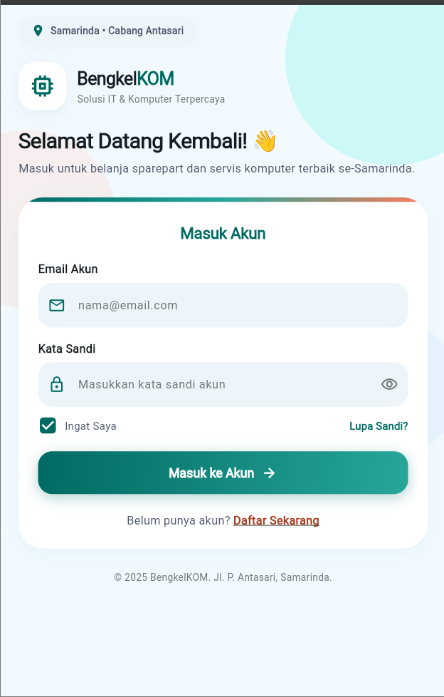
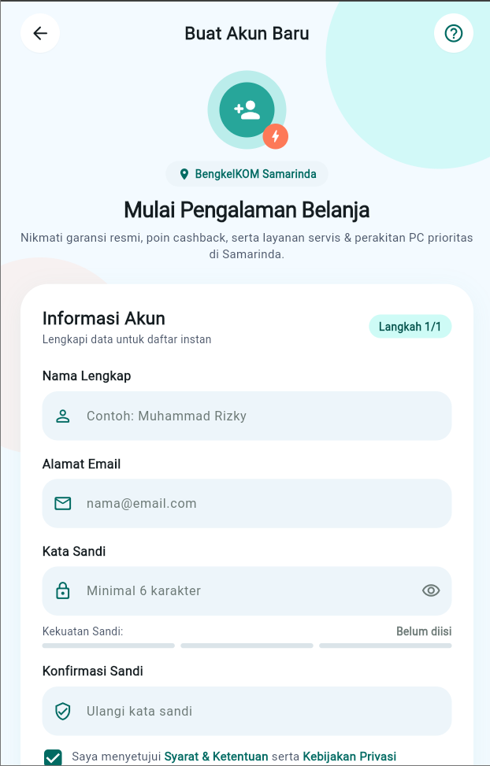
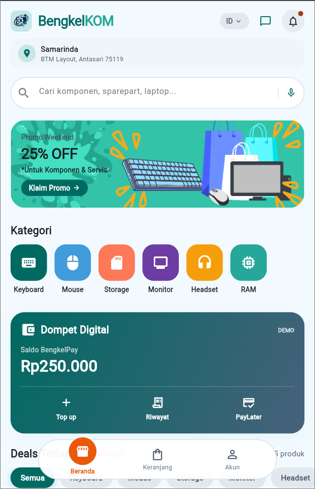
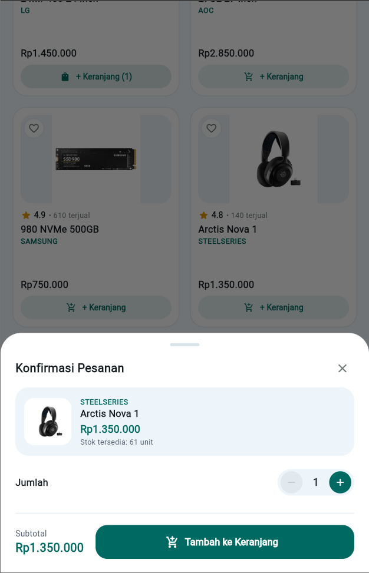
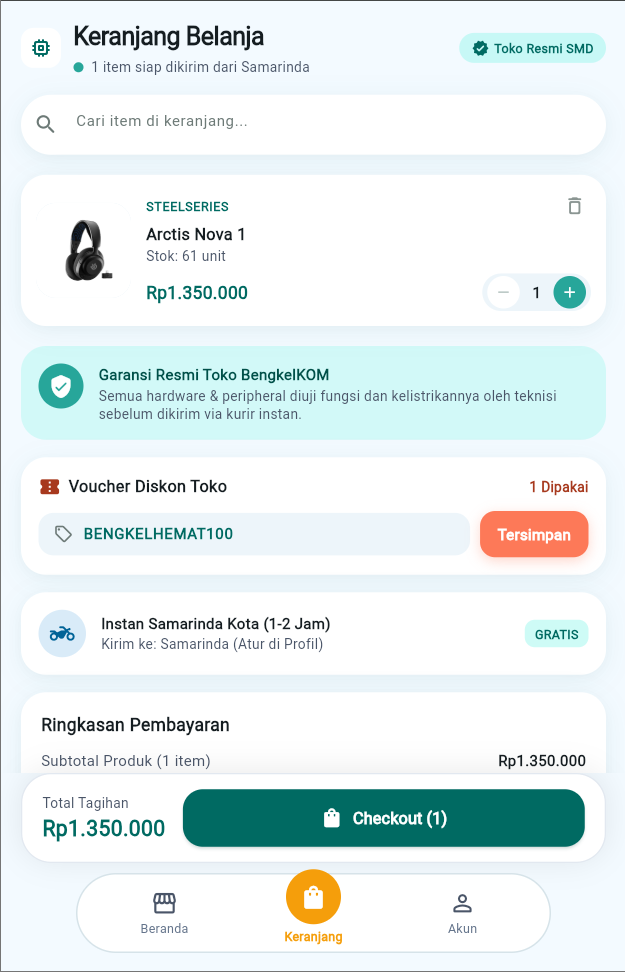
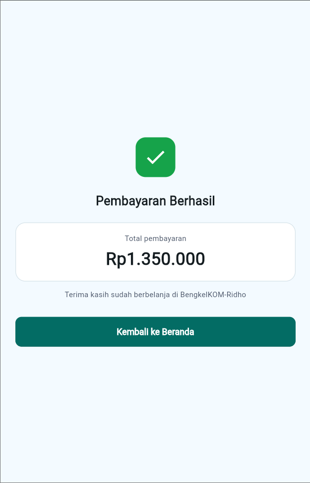
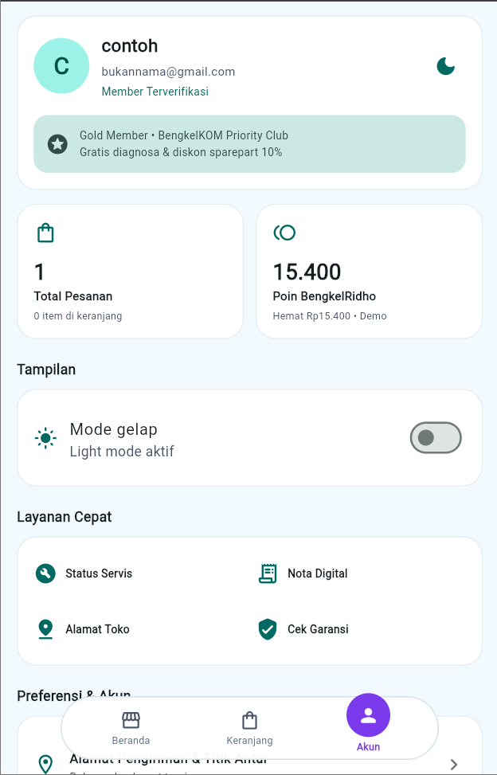
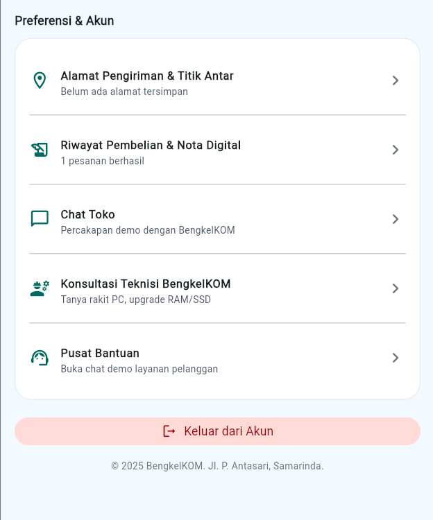
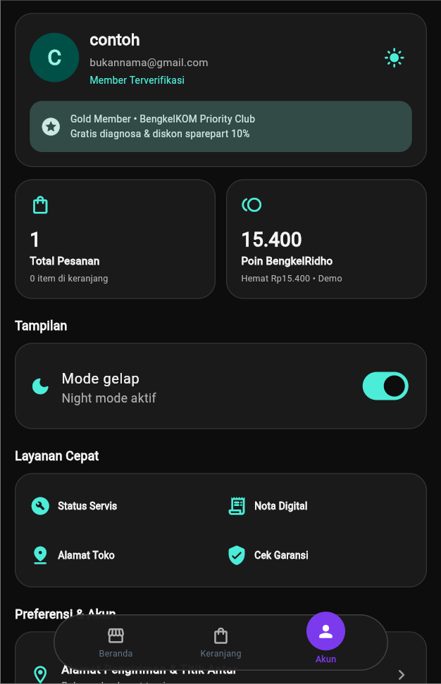

# BengkelKOM-Ridho

BengkelKOM-Ridho adalah aplikasi toko peralatan komputer berbasis **Flutter dan Dart**. Aplikasi ini menyediakan fitur autentikasi pengguna, katalog produk, pencarian dan filter, keranjang belanja, checkout, riwayat pesanan, serta pengelolaan alamat pengiriman. Data aplikasi terhubung dengan **Firebase Authentication** dan **Cloud Firestore**.

> Kode aplikasi Flutter berada di folder `PA-Mobile/`. Jalankan perintah Flutter dari dalam folder tersebut.

## Anggota Kelompok

Lengkapi tabel berikut sesuai data kelompok.

| Nama | NIM |
|---|---|
| Syafiq Hafizh Farizi | 2409106009 | 
| Zulfikar Aryawinata | 2409106020 | 
| Ridho Setiawan | 2409106029 | 
| Raffi Zidane Wahyudin | 2409106037 | 
| Rangga Aditya Rahman | 2409106044 | 

## Fitur Utama

- Registrasi, login, dan logout menggunakan Firebase Authentication.
- Beranda dengan pencarian produk, banner promosi, dan kategori.
- Filter produk berdasarkan kategori, merek, rentang harga, dan urutan.
- Data produk yang dibaca dari Cloud Firestore.
- Keranjang belanja: menambah, mengubah jumlah, dan menghapus barang.
- Checkout dengan pemeriksaan stok, penyimpanan pesanan, dan pengosongan keranjang.
- Riwayat pembelian berdasarkan akun pengguna.
- Pengelolaan alamat pengiriman.
- State management menggunakan Provider.

Beberapa elemen, seperti voucher, biaya pengiriman/asuransi, dan informasi keanggotaan tertentu, masih berupa tampilan demo dan belum seluruhnya terhubung ke database.

## Teknologi

| Teknologi | Kegunaan |
|---|---|
| Flutter | Framework antarmuka aplikasi |
| Dart | Bahasa pemrograman |
| Provider | Pengelolaan state aplikasi |
| Firebase Authentication | Registrasi, login, dan sesi pengguna |
| Cloud Firestore | Penyimpanan dan sinkronisasi data |
| Git dan GitHub | Version control dan kolaborasi tim |

## Persyaratan

Sebelum menjalankan aplikasi, pastikan perangkat sudah memiliki:

- Flutter SDK yang kompatibel dengan batas versi di `PA-Mobile/pubspec.yaml`.
- Dart SDK yang memenuhi persyaratan proyek (saat ini `^3.13.2`).
- Android Studio dan Android SDK untuk menjalankan di perangkat/emulator Android, atau Google Chrome untuk menjalankan versi web.
- Koneksi internet untuk mengakses Firebase.

Periksa instalasi Flutter dengan:

```bash
flutter doctor
```

## Cara Menjalankan

1. Clone repository jika belum tersedia di komputer:

   ```bash
   git clone URL_REPOSITORY
   ```

2. Masuk ke folder repository, lalu ke folder aplikasi:

   ```bash
   cd NAMA_REPOSITORY/PA-Mobile
   ```

   Jika terminal sudah berada di folder repository, cukup jalankan:

   ```bash
   cd PA-Mobile
   ```

3. Unduh dependensi:

   ```bash
   flutter pub get
   ```

4. Jalankan di Google Chrome:

   ```bash
   flutter run -d chrome
   ```

   Atau jalankan pada perangkat/emulator Android yang sudah terhubung:

   ```bash
   flutter devices
   flutter run
   ```

## Konfigurasi Firebase

Aplikasi menggunakan Firebase Authentication dan Cloud Firestore. Konfigurasi platform saat ini terdapat pada file konfigurasi Firebase di proyek.

Jika ingin menjalankan aplikasi dengan Firebase milik sendiri:

1. Buat proyek melalui [Firebase Console](https://console.firebase.google.com/).
2. Aktifkan metode login **Email/Password** pada Firebase Authentication.
3. Siapkan Cloud Firestore dan buat struktur koleksi/dokumen yang dibutuhkan aplikasi.
4. Hubungkan proyek Flutter dengan proyek Firebase menggunakan FlutterFire CLI.
5. Pastikan aturan keamanan Firestore membatasi akses data sesuai akun dan kebutuhan aplikasi.
6. Jalankan kembali `flutter pub get` dan aplikasi.

Jangan mengunggah service-account key, token, password, file `.env` berisi rahasia, atau kredensial pribadi ke repository. Periksa juga pengaturan akses dan aturan keamanan Firebase sebelum aplikasi digunakan secara publik.

## Struktur Repository

```text
repository/
├── README.md
└── PA-Mobile/
    ├── pubspec.yaml
    ├── assets/
    │   └── images/
    ├── android/
    ├── web/
    └── lib/
        ├── main.dart
        ├── firebase_options.dart
        ├── models/
        ├── pages/
        ├── providers/
        ├── theme/
        ├── utils/
        └── widgets/
```

Ringkasan direktori aplikasi:

- `lib/pages/` — halaman login, registrasi, beranda, kategori, keranjang, akun, alamat, dan riwayat pesanan.
- `lib/models/` — model data produk, kategori, alamat, dan pesanan.
- `lib/providers/` — pengelolaan state dan interaksi data aplikasi.
- `lib/widgets/` — komponen antarmuka yang digunakan ulang.
- `lib/theme/` — warna dan tema aplikasi.
- `assets/images/` — gambar dan aset visual.

## Kolaborasi

Proyek dikelola menggunakan Git dan GitHub. Sebelum mulai bekerja, ambil perubahan terbaru dari branch yang digunakan:

```bash
git pull
```

Setelah mengerjakan perubahan, periksa file yang berubah lalu commit dan push ke branch yang sesuai dengan aturan kelompok:

```bash
git status
git add .
git commit -m "docs: memperbarui dokumentasi"
git push
```

Jika kelompok menggunakan branch dan Pull Request, kirim perubahan ke branch fitur lalu ajukan Pull Request untuk ditinjau sebelum digabungkan ke branch utama.

## Tampilan Aplikasi

Bagian ini menampilkan tampilan antarmuka aplikasi BengkelKOM, mulai dari halaman login dan registrasi hingga fitur utama aplikasi, keranjang, invoice, profil pengguna, serta mode gelap.

### 1. LoginPage

Halaman login digunakan oleh pengguna untuk masuk ke aplikasi menggunakan akun yang telah terdaftar.



### 2. RegistPage

Halaman registrasi digunakan oleh pengguna baru untuk membuat akun agar dapat menggunakan aplikasi.



### 3. MainPage

Halaman utama aplikasi yang menjadi tempat pengguna melihat informasi dan mengakses fitur utama yang tersedia.



### 4. PickItem

Halaman pemilihan item yang digunakan pengguna untuk melihat dan memilih barang yang ingin dibeli.



### 5. CartPage

Halaman keranjang yang menampilkan barang-barang yang telah dipilih pengguna sebelum melanjutkan proses pembelian.



### 6. InvoicePage

Halaman invoice yang menampilkan informasi transaksi atau ringkasan pembelian pengguna.



### 7. ProfilPage1

Tampilan pertama halaman profil yang menampilkan informasi pengguna dan fitur terkait akun.



### 8. ProfilPage2

Tampilan kedua halaman profil yang memperlihatkan bagian lanjutan dari halaman profil pengguna.



### 9. DarkMode

Tampilan aplikasi dalam mode gelap (*dark mode*) untuk memberikan alternatif tema antarmuka yang lebih nyaman digunakan dalam kondisi pencahayaan rendah.


